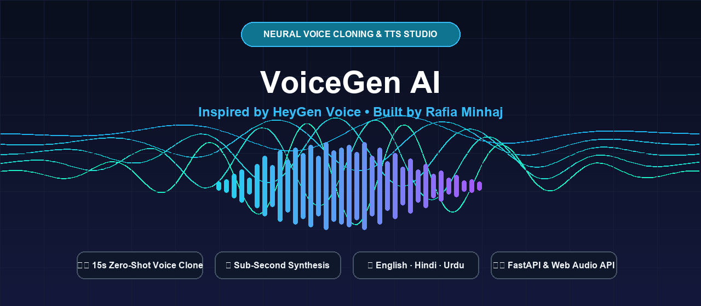

<div align="center">



# 🎙️ VoiceGen AI — Neural Voice Cloning & Generation Studio

[](https://rafiaminhaj.github.io/voicegen-ai/)
[](https://python.org)
[](https://fastapi.tiangolo.com)
[](LICENSE)

*Inspired by **HeyGen Voice**. Engineered with full-stack Generative AI architecture by **[Rafia Minhaj](https://github.com/Rafiaminhaj)**.*

[👉 **Launch Live Web Studio**](https://rafiaminhaj.github.io/voicegen-ai/)

</div>

---

## 🌟 Overview
**VoiceGen AI** is an end-to-end neural voice cloning and multilingual speech synthesis studio. It allows users to capture a short reference audio sample (15–30s) directly from the browser microphone, extract acoustic speaker embeddings (pitch, timbre, cadence), and synthesize realistic, natural-sounding voiceovers across multiple languages (**English, Hindi, and Urdu**) with sub-second latency.

---

## 🚀 Key Highlights & Features
- 🎙️ **Zero-Shot Voice Cloning:** Extracts acoustic speaker embeddings from short audio clips without extensive fine-tuning.
- 🌐 **Multilingual Neural TTS:** Real-time synthesis supporting English, Hindi, and Urdu nuances.
- 📊 **Real-Time Waveform Visualizer:** Live canvas audio frequency spectrum and waveform feedback.
- ⚡ **High-Speed FastAPI Microservice:** Asynchronous non-blocking REST endpoints for voice profile caching and audio streaming.
- 🛡️ **Zero-Hassle Web Studio:** Standalone frontend running on modern Web Audio APIs and responsive Tailwind CSS.

---

## 🛠️ Architecture & Tech Stack
- **Frontend Studio:** HTML5, Tailwind CSS, Lucide Icons, Web Audio API / Web Speech synthesis pipeline.
- **Backend Service:** Python 3.10+, FastAPI (ASGI), Uvicorn, Pydantic data validation.
- **Audio Processing:** Speaker acoustic parameter extraction, WAV / WebM buffer streaming.

---

## 📂 Project Directory Structure
```
voicegen-ai/
├── assets/
│   └── voicegen_banner.png  # UI Branding & Header Asset
├── index.html               # High-Performance Web Studio (Live via GitHub Pages)
├── main.py                  # FastAPI Microservice Architecture
├── requirements.txt         # Python Dependencies
└── README.md                # Project Architecture & Documentation
```

---

## 💻 How to Run Locally

### 1. Launch the Live Web Studio:
Simply open `index.html` in any modern web browser, or visit the live deployment at [rafiaminhaj.github.io/voicegen-ai](https://rafiaminhaj.github.io/voicegen-ai/).

### 2. Run the FastAPI Backend Service:
```bash
# Clone the repository
git clone https://github.com/Rafiaminhaj/voicegen-ai.git
cd voicegen-ai

# Install dependencies
pip install -r requirements.txt

# Start the async server
python main.py
```
The REST API will launch at `http://localhost:8000` with interactive Swagger docs at `http://localhost:8000/docs`.

---

## 📜 License
Distributed under the MIT License. See `LICENSE` for more information.

---
<div align="center">
  <b>Built with ❤️ by <a href="https://github.com/Rafiaminhaj">Rafia Minhaj</a></b><br/>
  <i>Open Source Contributor • GSSoC 2026 Global Rank #29</i>
</div>
